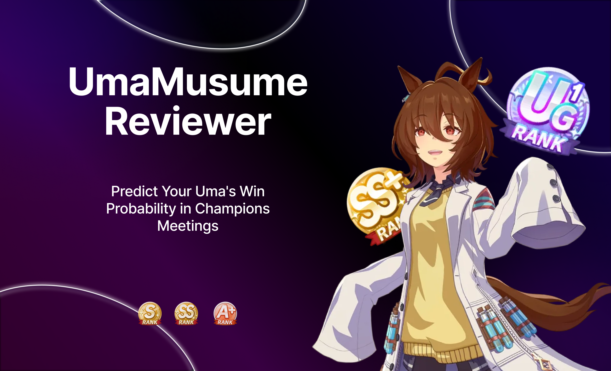

# UmaMusume Champions Meeting Reviewer

---
Introducing **UmaMusume CM Reviewer**, this product was designed to help players evaluate their Uma's capability for the Champions Meeting.

## Why I Made This
Every time a new Champions Meeting drops, the meta shifts drastically. Opponents just keep getting stronger, which leaves casual and F2P players like me struggling to keep up. This frustration led me to build this project to get concrete answers about:  
  - "Is my Uma strong enough to compete in the next CM?"
  - "When should I stop training my Uma?"
  - "Why does my Uma keep losing?"

## Tech Stack

## 🧩 How It Works

### Data Collecting

- **✂️ Image Preprocessing** — Hardcoded pixel positions broke whenever a screenshot shifted a bit. So I use OpenCV's `morphologyEX` to find the boxes (skills, aptitude, etc.) and crop with their coordinates, plus a small offset for a cleaner result. Now the crop stays precise whenever the UI sits.
   
- **✒️ Image Processing (OCR)** — Each crop i read by CRNN model, which returns raw text. Names (skills, characters, moods) are then matched against reference lists with RapidFuzz to fix small reading errors. The results are stored per category (detail, mood, rank).

- **🔍 Matching Data** — Info about uma (character) is spread across several screenshots. The pipeline links them by name, stats, and favorite number. then merges them into one profile per uma (character). Each profile is saved as structured JSON.

- **🧠 Machine Learning** — 

## About This Project
I started this project as a beginner, and I built this for over ~5 months, and it's how I learned to code. I designed the pipeline, the matching logic, and the data cleaning workflow myself. I used AI as a mentor for syntax and for choosing library functions (OpenCV, PyTorch).

## 📁 Documentation
- **test** 

## 📄 License

This project is licensed under the Apache License 2.0 - see the [LICENSE](LICENSE) file for details.

---

> **Disclaimer:** This is an unofficial, non-commercial fan project. *Uma Musume: Pretty Derby* and all associated assets, character names, and logos are trademarks/copyrights of Cygames, Inc.